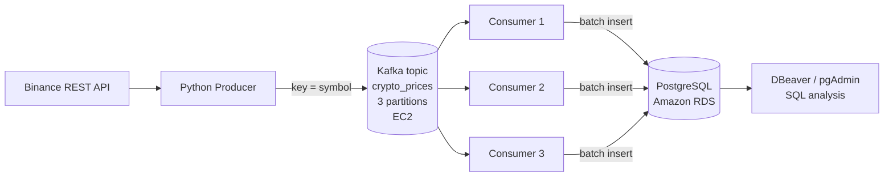

# Real-Time Crypto Prices Pipeline: Binance → Kafka (EC2) → PostgreSQL (RDS)

A hands-on streaming data engineering project that collects live cryptocurrency prices (BTC, ETH, SOL, BNB) from the Binance API, streams them through Apache Kafka running on AWS EC2, and loads them in batches into PostgreSQL on Amazon RDS for SQL analysis.

## Architecture



**How it works**

1. The **producer** polls Binance every 2 seconds and publishes one JSON message per coin. The coin symbol is the message key, so a given coin always lands in the same partition and stays in order.
2. **Kafka** (with Zookeeper) runs on a single EC2 instance. The topic `crypto_prices` has 3 partitions.
3. One or more **consumers** in the same consumer group (`crypto-loader`) split the partitions between them and insert rows into PostgreSQL in batches.
4. Kafka offsets are committed **only after** the database commit succeeds, giving at-least-once delivery (a crash can cause duplicates, never lost data).

## Tech Stack

| Layer | Technology |
|---|---|
| Data source | Binance public REST API |
| Message broker | Apache Kafka 3.3.1 + Zookeeper on AWS EC2 |
| Producer / consumer | Python 3.11, `kafka-python`, `requests` |
| Database | PostgreSQL on Amazon RDS |
| DB driver | `psycopg2` (`execute_values` for batch inserts) |
| Analysis | SQL (DBeaver / pgAdmin) |

## Repository Structure

```
.
├── producer.ipynb        # Binance -> Kafka producer
├── consumer.ipynb        # Kafka -> PostgreSQL consumer + verification queries
├── command_kafka.txt     # EC2 / Kafka setup commands
├── docs/
│   └── Real-Time_Crypto_Prices_with_Kafka_on_AWS_Lab_Guide.pdf
├── .env.example          # Placeholder configuration (copy to .env)
├── .gitignore
└── README.md
```

## Prerequisites

- AWS account (region used here: `eu-north-1`, Stockholm)
- EC2 instance with Java and Kafka 3.3.1 extracted to `kafka_2.12-3.3.1`
- RDS PostgreSQL instance (plain PostgreSQL, public access enabled for the lab)
- Python 3.11 with Jupyter or VS Code on your laptop
- DBeaver or pgAdmin
- Your laptop's public IP, for security group rules

```bash
pip install kafka-python requests psycopg2-binary python-dotenv
```

## Configuration

Never hardcode credentials. Copy `.env.example` to `.env` and fill it in:

```env
KAFKA_BROKER=EC2_PUBLIC_IP:9092
KAFKA_TOPIC=crypto_prices
PGHOST=your-instance.xxxx.eu-north-1.rds.amazonaws.com
PGPORT=5432
PGDATABASE=postgres
PGUSER=postgres
PGPASSWORD=change_me
```

Download the RDS CA bundle (`global-bundle.pem`) from AWS and place it next to the notebooks to use `sslmode=verify-full`.

## Setup and Run

### 1. Start Kafka on EC2

Open three SSH sessions to the instance.

```bash
# Terminal A - Zookeeper
cd kafka_2.12-3.3.1
bin/zookeeper-server-start.sh config/zookeeper.properties

# Terminal B - Kafka (after setting advertised.listeners)
cd kafka_2.12-3.3.1
export KAFKA_HEAP_OPTS="-Xmx256M -Xms128M"
bin/kafka-server-start.sh config/server.properties
```

In `config/server.properties`, set the public address, then restart Kafka:

```properties
advertised.listeners=PLAINTEXT://EC2_PUBLIC_IP:9092
```

Open port **9092** in the EC2 security group, source **My IP** only.

### 2. Create the topic (3 partitions)

```bash
bin/kafka-topics.sh --create --topic crypto_prices \
  --bootstrap-server EC2_PUBLIC_IP:9092 --replication-factor 1 --partitions 3

bin/kafka-topics.sh --describe --topic crypto_prices \
  --bootstrap-server EC2_PUBLIC_IP:9092
```

### 3. Create the database table

Open port **5432** on the RDS security group to your IP, then run:

```sql
CREATE TABLE IF NOT EXISTS crypto_prices (
  symbol          VARCHAR(20),
  price           DECIMAL(18,8),
  event_ts        TIMESTAMP,
  kafka_partition INT,
  kafka_offset    BIGINT
);
```

### 4. Run the pipeline

1. Run `producer.ipynb`. Each coin prints its partition and offset every 2 seconds.
2. Run `consumer.ipynb`. It loads rows in batches (`BATCH_SIZE`, 10 for testing, 50 for normal use).
3. Verify:

```sql
SELECT COUNT(*) FROM crypto_prices;
SELECT * FROM crypto_prices ORDER BY event_ts DESC LIMIT 10;
```

Quick check that messages reach Kafka:

```bash
bin/kafka-console-consumer.sh --topic crypto_prices \
  --bootstrap-server EC2_PUBLIC_IP:9092 --from-beginning
```

## Parallel Consumption Demo

Partitions are the unit of parallelism. Start several copies of the consumer with the same `group_id`:

| Consumers running | Partition assignment |
|---|---|
| 1 | `[0, 1, 2]` |
| 2 | `[0, 1]` and `[2]` |
| 3 | `[0]`, `[1]`, `[2]` |
| 4 | the fourth sits idle |

Stop one copy and the remaining consumers take over its partition (rebalance). Check the spread:

```sql
SELECT kafka_partition, COUNT(*) AS rows_loaded
FROM crypto_prices
GROUP BY kafka_partition
ORDER BY kafka_partition;
```

## Example SQL Analysis

```sql
-- Latest price per coin
SELECT symbol, price, event_ts FROM (
  SELECT *, ROW_NUMBER() OVER (PARTITION BY symbol ORDER BY event_ts DESC) AS rn
  FROM crypto_prices) t
WHERE rn = 1;

-- One-minute statistics
SELECT symbol, DATE_TRUNC('minute', event_ts) AS minute,
       MIN(price) AS low, MAX(price) AS high, AVG(price) AS avg_price, COUNT(*) AS ticks
FROM crypto_prices
GROUP BY 1, 2
ORDER BY 2 DESC, 1;

-- Biggest price swing per coin
SELECT symbol, MAX(price) - MIN(price) AS swing
FROM crypto_prices
GROUP BY symbol
ORDER BY swing DESC;
```

## Reliability Notes

- **At-least-once delivery:** the consumer commits to the database first, then to Kafka. To make reloads safe, add a unique constraint and skip duplicates:

```sql
ALTER TABLE crypto_prices
  ADD CONSTRAINT uq_partition_offset UNIQUE (kafka_partition, kafka_offset);
```

```python
INSERT INTO crypto_prices (symbol, price, event_ts, kafka_partition, kafka_offset)
VALUES %s
ON CONFLICT (kafka_partition, kafka_offset) DO NOTHING
```

- **Graceful shutdown:** wrap the consume loop in `try/except/finally` and call `consumer.close()` so the group rebalances immediately.

## Troubleshooting

| Problem | Likely fix |
|---|---|
| `NoBrokersAvailable` / `KafkaTimeoutError` | Kafka not running, wrong or changed EC2 IP, `advertised.listeners` not updated, or port 9092 blocked |
| Consumer prints nothing | Topic name mismatch (`crypto_prices` vs `crypto_price`) or producer not running |
| Binance HTTP 451/403 | Region restriction; use `https://data-api.binance.vision/api/v3/ticker/price` |
| `psycopg2` connection timeout | RDS public access off, port 5432 closed to your current IP, or instance not Available |
| `database ... does not exist` | Connect to `postgres` and run `CREATE DATABASE crypto;` |
| No rows yet | The batch is not full; wait for `BATCH_SIZE` messages |

The EC2 public IP changes when the instance is stopped and started. Attach an Elastic IP to avoid updating configs each time.

## Security Checklist

- Do **not** commit `.env`, SSH key pairs (`*.pem` other than the public RDS `global-bundle.pem`), or passwords.
- Never leave an `All traffic / 0.0.0.0/0` rule on any security group. Open only 9092 and 5432, only to your IP.
- Use a strong database password and rotate any credential that was ever committed.

## Clean Up

To avoid AWS charges when finished:

1. Stop the producer and all consumers.
2. Delete the RDS instance.
3. Stop or terminate the EC2 instance.
4. Remove unneeded security group rules and check billing after a day or two.

## Future Improvements

- Replace the Python consumer with **Spark Structured Streaming** (`foreachBatch` with `maxOffsetsPerTrigger`) for chunked loading at scale
- Add a second consumer group (`price-alerts`) that flags moves above 0.5% per minute
- Write batches to S3 as Parquet
- Move Kafka and the database into private subnets in a VPC
- Replace Zookeeper with KRaft mode
- Add a Grafana or Streamlit dashboard on top of PostgreSQL

## Acknowledgements

Based on the *Real-Time Crypto Prices with Kafka on AWS* lab guide.

## License

MIT (add a `LICENSE` file if you want to publish under this license).
